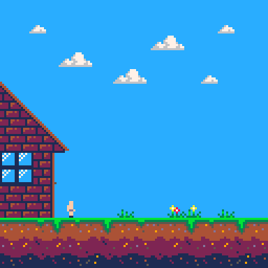
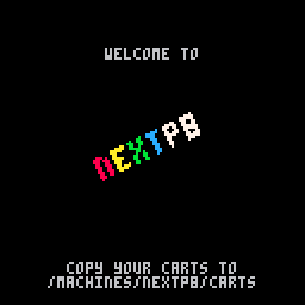
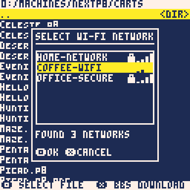
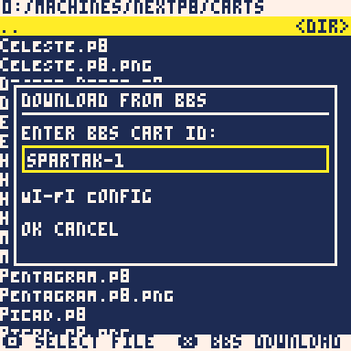

nextp8
======

nextp8 is a hobby project to make a Pico-8 compatible 'core' for the ZX Spectrum Next.

[Download](download.md)

The Pico-8 is a fantasy 8-bit games console. The fantasy bit means that Pico-8 is a purely software implementation; there is no real Pico-8 hardware. Programs are written in Lua, a language not too aesthetically dissimilar from the Basic that ruled the 8-bit home computer heyday. [Go buy a copy of Pico-8](https://www.lexaloffle.com/pico-8.php).

<table>
  <tr>
    <td></td>
    <td></td>
  </tr>
  <tr>
    <td></td>
    <td></td>
  </tr>
</table>

* [Download](download.md)
* [PICO-8 Compatibility](compatibility.md)
* [Platform Information](platform.md)
* [Build Instructions](building.md)
