Download
========

nextp8 will be available for download soon!

Installation
------------

### Step 1: Download the Installer

Download the file above and unzip it.

You can do this on a PC/Mac or on the Next itself.

To unzip files on the Next use the `.unzip` dot command, e.g.

```
.unzip "nextp8-release.zip"
```

### Step 2: Navigate to the Installer in the Browser

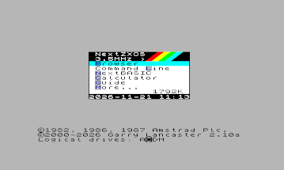

Start the Browser to begin the installation process.

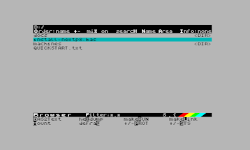

Navigate to the drive and path containing the installer files.

### Step 3: Start the Installer

Select `installer-nextp8.bas` in the Browser and press **ENTER**.

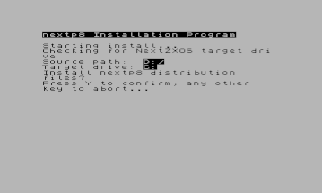

### Step 4: Confirm the Installation

Press **Y** to confirm the installation settings.

### Step 5: Installer Completed

Wait for the install to complete.

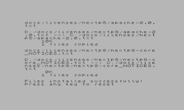

The installer completes successfully.

Press any key to reset the Next.

### Step 6: Core Selection

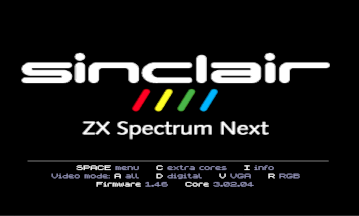

At the boot splash screen press **C** for *extra cores*.

Press **Right** until you see the nextp8 core.

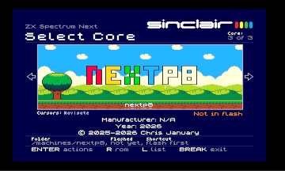

### Step 7: Flash Core

Press **ENTER** to start flashing the core.

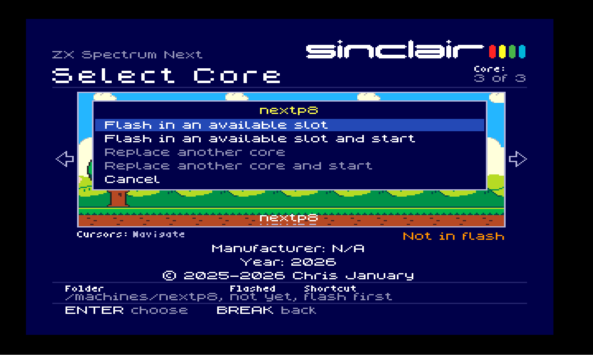

### Step 8: Flash Core - Choose Slot

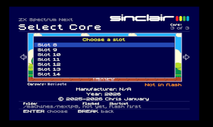

Select the target core slot for flashing and press **ENTER**

### Step 9: Flash Core - Confirm

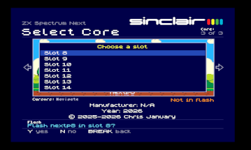

Press **Y** to confirm the core flashing operation.

### Step 10: Flash Core - Progress

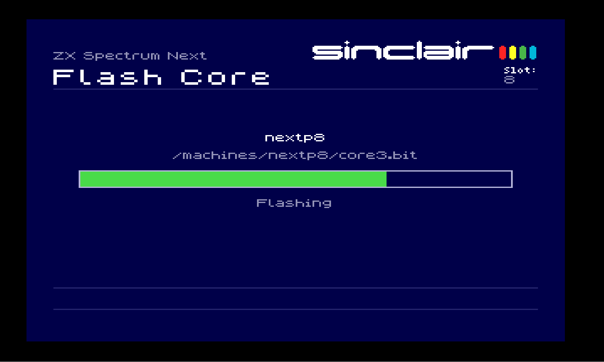

Watch the flashing progress indicator.

### Step 11: Flash Core - Done

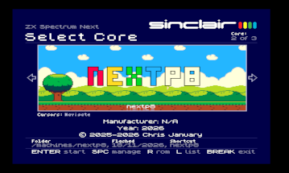

Core flashing complete.

### Step 12: Core Loading

Press **ENTER** to start the core.

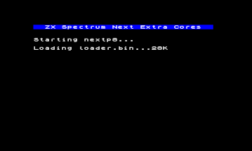

The core starts loading.

### Step 13: nextp8 Boot

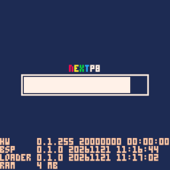

nextp8 starts booting.

### Step 14: nextp8 Browser

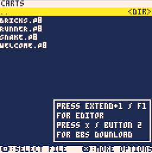

The nextp8 browser interface is ready.

### Step 15: nextp8 Browser Welcome

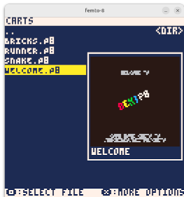

Select `welcome.png` in the nextp8 browser using **DOWN** and then **ENTER**.

### Step 16: nextp8 Welcome

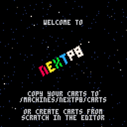

Welcome to nextp8!

### More Information

For more information read the [Install Guide](ug/install.md) and check the *Booting, Adding, Removing or Replacing an Extra Core* section of the Quick Start guide that came with your Next.

Licences
--------

Cover image credit: GrafxKid

### nextp8

Copyright (C) 2025-2026 Chris January<br>
Licensed under [Creative Commons Attribution-ShareAlike 4.0](https://creativecommons.org/licenses/by-sa/4.0/).

### nextp8-core

Copyright (C) 2025-2026 Chris January and other authors.<br>
Source Code: [https://github.com/atomice1/nextp8-core/](https://github.com/atomice1/nextp8-core/)<br>
Licensed under the [GNU General Public License 3.0 or later](licences/gpl-3.0.txt)

[nextp8-core licence notices](licences/nextp8-core_NOTICES.txt)

### femto8-nextp8

Copyright (C) 2025-2026 Chris January<br>
Copyright 2023 Ben Baker

Permission is hereby granted, free of charge, to any person obtaining a copy of
this software and associated documentation files (the “Software”), to deal in
the Software without restriction, including without limitation the rights to
use, copy, modify, merge, publish, distribute, sublicense, and/or sell copies of
the Software, and to permit persons to whom the Software is furnished to do so,
subject to the following conditions:

The above copyright notice and this permission notice shall be included in all
copies or substantial portions of the Software.

THE SOFTWARE IS PROVIDED “AS IS”, WITHOUT WARRANTY OF ANY KIND, EXPRESS OR
IMPLIED, INCLUDING BUT NOT LIMITED TO THE WARRANTIES OF MERCHANTABILITY, FITNESS
FOR A PARTICULAR PURPOSE AND NONINFRINGEMENT. IN NO EVENT SHALL THE AUTHORS OR
COPYRIGHT HOLDERS BE LIABLE FOR ANY CLAIM, DAMAGES OR OTHER LIABILITY, WHETHER
IN AN ACTION OF CONTRACT, TORT OR OTHERWISE, ARISING FROM, OUT OF OR IN
CONNECTION WITH THE SOFTWARE OR THE USE OR OTHER DEALINGS IN THE SOFTWARE.

[femto8-nextp8 licence notices](licences/femto8-nextp8_NOTICES.txt)

### nextp8-bsp

Copyright (C) 2025-2026 Chris January<br>
Portions copyright various authors

The authors hereby grant permission to use, copy, modify, distribute,
and license this software and its documentation for any purpose, provided
that existing copyright notices are retained in all copies and that this
notice is included verbatim in any distributions. No written agreement,
license, or royalty fee is required for any of the authorized uses.
Modifications to this software may be copyrighted by their authors
and need not follow the licensing terms described here, provided that
the new terms are clearly indicated on the first page of each file where
they apply.

Some components are licensed under the [Apache License 2.0](licences/apache-2.0.txt).

[nextp8-bsp licence notices](licences/nextp8-bsp_NOTICES.txt)

### nextp8-loader

Copyright (C) 2025-2026 Chris January

Permission is hereby granted, free of charge, to any person obtaining a copy of
this software and associated documentation files (the "Software"), to deal in
the Software without restriction, including without limitation the rights to
use, copy, modify, merge, publish, distribute, sublicense, and/or sell copies of
the Software, and to permit persons to whom the Software is furnished to do so,
subject to the following conditions:

The above copyright notice and this permission notice shall be included in all
copies or substantial portions of the Software.

THE SOFTWARE IS PROVIDED "AS IS", WITHOUT WARRANTY OF ANY KIND, EXPRESS OR
IMPLIED, INCLUDING BUT NOT LIMITED TO THE WARRANTIES OF MERCHANTABILITY, FITNESS
FOR A PARTICULAR PURPOSE AND NONINFRINGEMENT. IN NO EVENT SHALL THE AUTHORS OR
COPYRIGHT HOLDERS BE LIABLE FOR ANY CLAIM, DAMAGES OR OTHER LIABILITY, WHETHER
IN AN ACTION OF CONTRACT, TORT OR OTHERWISE, ARISING FROM, OUT OF OR IN
CONNECTION WITH THE SOFTWARE OR THE USE OR OTHER DEALINGS IN THE SOFTWARE.
